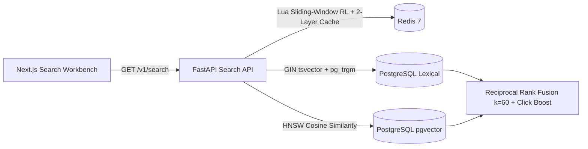
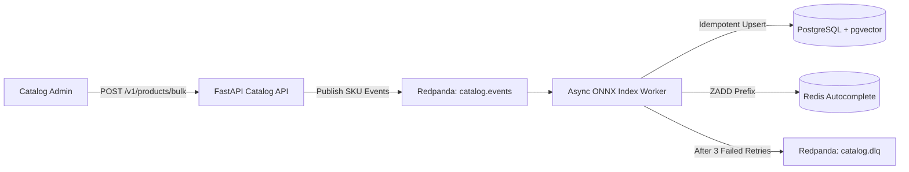

# RankForge — Hybrid E-Commerce Search & Ranking Engine

RankForge is a production-grade hybrid e-commerce search engine combining **BM25-style full-text search**, **trigram typo tolerance (`pg_trgm`)**, and **dense semantic vector retrieval (`pgvector` HNSW)** fused via **Reciprocal Rank Fusion (RRF)**, backed by an event-driven **Redpanda (Kafka)** indexing pipeline and a **Next.js** interactive search workbench.

## Architecture

### Read Path (Low-Latency Hybrid Search)


### Write Path (Async Catalog Indexing + DLQ)


## Key Engineering Highlights
- **Hybrid Retrieval + RRF (`k=60`):** Normalizes unbounded lexical ranks and cosine vector ranks onto a shared scale, plus a stock-aware `log1p(click_count)` popularity tie-breaker.
- **Indian E-Commerce Search Challenges:** Handles Hinglish synonyms (`atta`, `chappal`, `mixie`), typos (`samung`, `ifone`), and semantic intent (`quiet keyboard for office`).
- **Two-Layer Redis Caching:** Layer 1 caches full search responses (`60s` TTL, `X-Cache: HIT|MISS`); Layer 2 caches 384-dim query embeddings (`1h` TTL) so facet changes skip ONNX inference.
- **Atomic Sliding-Window Rate Limiting:** Redis Lua script enforces per-client RPM limits across multiple stateless replicas with fail-open degradation if Redis is unreachable.
- **Offline Quality & Load Benchmarks:** Includes an `NDCG@5`/`MRR` evaluation harness (`eval/evaluate_ndcg.py`) and a `k6` load-test script (`benchmarks/k6_search_load.js`).

## Quick Start (Docker Compose)

```bash
# 1. Start PostgreSQL (auto-applies schema.sql), Redis, Redpanda, API, Indexer, and Frontend
docker compose up --build -d

# 2. Seed sample Indian e-commerce catalog via the Redpanda pipeline
docker exec -i rankforge-api python -m app.db.seed

# 3. Open the Interactive Search Workbench & Swagger Docs
# Storefront + Explain Inspector: http://localhost:3000
# OpenAPI / Swagger UI:           http://localhost:8000/docs
```

## API Reference

| Method & Endpoint | Auth | Description |
| :--- | :--- | :--- |
| `GET /v1/search` | Public (Rate-limited) | Hybrid/lexical/vector search with facets & `explain=true` |
| `GET /v1/autocomplete` | Public (Rate-limited) | Redis `ZRANGEBYLEX` prefix suggestions |
| `POST /v1/events/click` | Public | Logs search clicks and increments popularity signal |
| `POST /v1/products/bulk` | `X-API-Key` (Admin) | Publishes product upserts to Redpanda `catalog.events` |
| `GET /v1/health` | Public | Database liveness check |

## Running Tests & Benchmarks

```bash
# Unit & integration tests
cd backend && PYTHONPATH=. pytest -v

# Offline ranking evaluation (Lexical vs Vector vs Hybrid)
python eval/evaluate_ndcg.py

# Seed 10,000 SKUs and run k6 load test
PYTHONPATH=backend python benchmarks/seed_10k.py
k6 run benchmarks/k6_search_load.js
```

### Measured Results *(Run locally and record your real hardware outputs below)*

| Benchmark | Mode / Config | Measured Result |
| :--- | :--- | :--- |
| Offline Ranking (`eval/evaluate_ndcg.py`) | Lexical `NDCG@5` / `MRR` | _Run locally & record_ |
| Offline Ranking (`eval/evaluate_ndcg.py`) | Hybrid `NDCG@5` / `MRR` | _Run locally & record_ |
| Load Test (`k6`, 10k SKUs, 50 VUs) | p95 Latency / RPS | _Run locally & record_ |

## License
MIT
